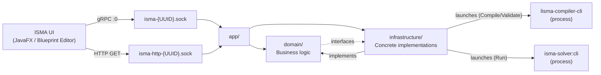
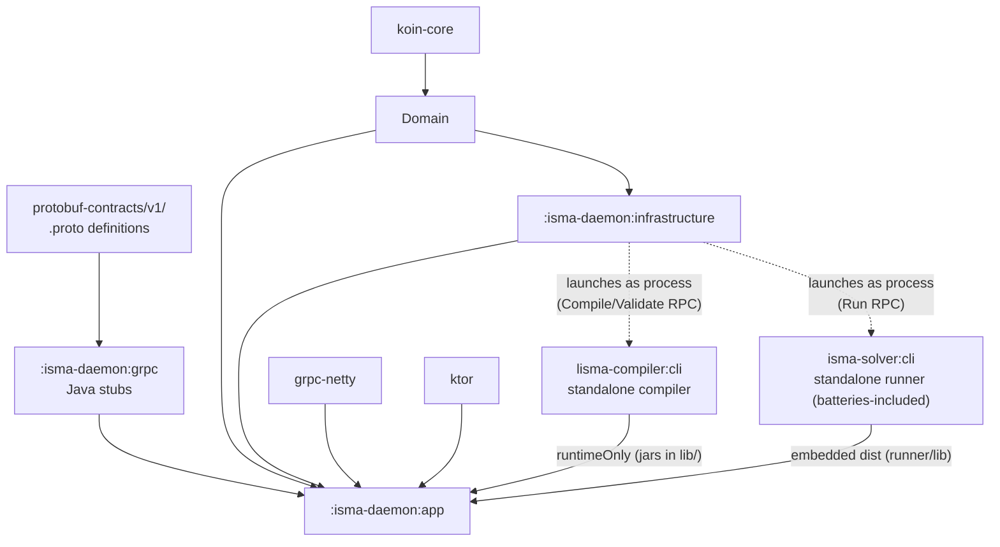
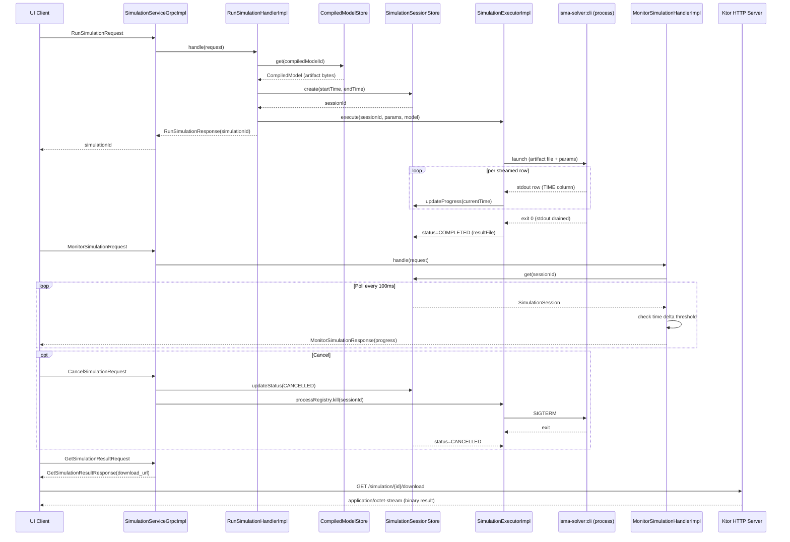
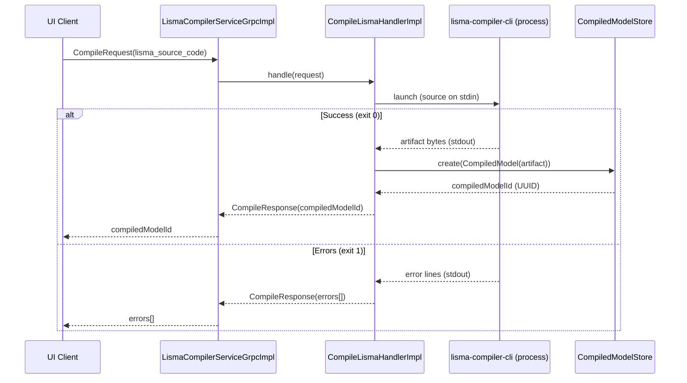

# ISMA Daemon Architecture Overview

## Purpose

`isma-daemon` is a gRPC-based orchestration daemon for the ISMA (Instrumental
Modeling) mathematical modeling environment. It provides simulation execution,
model compilation, and LISMA language services via a gRPC API using Unix domain
sockets for inter-process communication.

The daemon is a **pure orchestrator**. It performs no LISMA translation and no
in-process simulation. It launches two standalone CLI tools as separate
processes and coordinates them:

- **LISMA compiler CLI** (`lisma-compiler:cli`) — compiles LISMA source to a
  compiled `.class` file (analyzed hybrid-system class with the translated HSM
  inlined as a serialized blob) and validates LISMA.
- **Simulation runner CLI** (`isma-solver:cli`, batteries-included) — runs a simulation from a
  compiled `.class` file and writes the result file.

## Position in the ISMA Architecture

The ISMA UI (JavaFX / Blueprint Editor) communicates with the daemon via gRPC
over a Unix domain socket. The daemon consists of three internal modules:
`app/` (entry point and services), `domain/` (business logic), and
`infrastructure/` (concrete implementations). The daemon holds no solver jars of
its own; `ListSimulationMethods` asks the batteries-included runner CLI for its
method list. LISMA compilation and simulation are delegated to the two CLIs:
the compiler CLI ships in the app distribution's `lib/` directory, and the
runner ships as its own embedded distribution. Both are resolved via the
`ISMA_COMPILER_CLI` / `ISMA_RUNNER_CLI` environment variables (or
`isma.compiler.cli` / `isma.runner.cli` system properties).

The daemon communicates with the UI via a **two-service gRPC architecture**:

1. **SimulationService** — Run, monitor, and manage numerical simulations
2. **LismaCompilerService** — Compile, validate, and delete compiled LISMA models

## Module Structure

| Directory | Purpose |
|-----------|---------|
| `app/src/main/kotlin/ru/nstu/isma/daemon/app/` | Application entry point, gRPC & HTTP services |
| `Application.kt` | Main class, daemon startup |
| `AppModule.kt` | Koin DI module (gRPC service bindings) |
| `grpc/` | gRPC service implementations |
| `SimulationServiceGrpcImpl.kt` | SimulationService gRPC handler |
| `LismaCompilerServiceGrpcImpl.kt` | LismaCompilerService gRPC handler |
| `http/HttpRoutes.kt` | Ktor HTTP routes (result download) |
| `domain/src/main/kotlin/ru/nstu/isma/domain/` | Domain layer: interfaces + handler implementations |
| `DomainModule.kt` | Koin DI module (handler bindings) |
| `compiler/ICompiledModelStore.kt` | Compiled model store interface + `CompiledModel` (artifact bytes) |
| `compiler/ILismaCompiler.kt` | Compiler interface (compile → artifact, validate → errors) |
| `handlers/` | Handler packages (cancelSimulation, compileLisma, deleteCompiledModel, getSimulationResult, listSimulationMethods, monitorSimulation, runSimulation, validateLisma) |
| `integration/IIntegrationMethodsStore.kt` | Integration methods store interface |
| `simulation/` | Simulation domain (ISimulationExecutor, ISimulationProcessRegistry, ISimulationSessionStore, SimulationSession, SimulationStatus) |
| `infrastructure/src/main/kotlin/ru/nstu/isma/daemon/infrastructure/` | Infrastructure layer: concrete implementations |
| `simulation/SimulationExecutorImpl.kt` | Launches the runner CLI, reads the runner's stdout (deriving progress from the TIME column), completes/fails/cancels the session |
| `simulation/SimulationProcessRegistry.kt` | Tracks runner processes so CancelSimulation can kill them |
| `stores/` | Concrete store implementations (CompiledModelStore, IntegrationMethodsStore, SimulationSessionStore) |
| `translation/CliLismaCompiler.kt` | Launches the LISMA compiler CLI (compile → artifact, validate → error lines) |
| `grpc/` | gRPC code generation (proto → Java stubs) |
| Protobuf source | `../../protobuf-contracts/` |

### Module Dependencies
The `:isma-daemon:grpc` module generates Java stubs from protobuf definitions and has no project dependencies. The `:isma-daemon:domain` module depends only on `koin-core` (compiled models are stored as opaque `.class` bytes). The `:isma-daemon:infrastructure` module depends on `:isma-daemon:domain`, `koin-core`, and `slf4j-api`. The `:isma-daemon:app` module depends on all three internal modules, gRPC/Netty/Ktor libraries, and — via `runtimeOnly` — `lisma-compiler:cli`, so the compiler CLI jar lands in the distribution's `lib/` directory. The batteries-included runner (`isma-solver:cli`) is embedded as its own distribution (via the `installRunnerDist` task) so the daemon can launch both CLIs as separate processes.

## Design Principles

### 1. Interface-Based Domain Layer

The `domain/` module contains both **interfaces** and **handler implementations**, following a hexagonal architecture pattern. Interfaces define contracts; implementations are in the `infrastructure/` module. The `domain/` module's handler implementations depend on infrastructure interfaces declared in the same module.

### 2. Koin Dependency Injection

Three Koin modules are layered in startup order:

| Module                 | Contents                                                          |
| ---------------------- | ----------------------------------------------------------------- |
| `domainModule`         | All handler interfaces → implementations                          |
| `infrastructureModule` | All store interfaces → implementations, executor, process registry, compiler |
| `appModule`            | gRPC service implementations that wire handlers together          |

See `Application.kt` for the `startKoin { modules(domainModule, infrastructureModule, appModule) }` call that initializes all three modules. The `appModule` depends on the other two, so it must be loaded last.

### 3. Process Orchestration

The daemon never loads model classes or runs the solver in-process. Each
simulation runs in its own `isma-solver:cli` process, and each compile/validate
runs in its own `lisma-compiler:cli` process. This isolates crashes, allows the
solver/compiler to evolve independently (and be rewritten in another language
later), and keeps the daemon a thin coordination layer.

| Component            | Threading                                                        |
| -------------------- | ---------------------------------------------------------------- |
| gRPC calls           | Netty event loops (per-call)                                     |
| Simulation execution | Java `ExecutorService` (cached thread pool) — one thread supervises one runner process |
| Progress tracking    | The supervising thread reads the runner's stdout and derives progress from the TIME column |
| Session stores       | `ConcurrentHashMap` for lock-free thread safety                  |

## Communication Flow

### Simulation Lifecycle

The client sends a `RunSimulationRequest` to `SimulationServiceGrpcImpl`, which delegates to `RunSimulationHandlerImpl`. The handler retrieves the compiled model (artifact bytes) from `CompiledModelStore`, creates a new `SimulationSession`, and submits async execution to the `ExecutorService`. The daemon returns a `RunSimulationResponse` with the `simulationId`. The `SimulationExecutorImpl` writes the artifact to a temp file, launches the `isma-solver:cli` runner as a separate process, and reads the runner's stdout (which streams the binary result rows), deriving `progress = (t − t0) / (tEnd − t0)` from the TIME column to update the session. When the runner exits, the accumulated result is written to a file and the session is completed (result file path), failed, or left cancelled. The client can send `MonitorSimulationRequest` messages, which trigger a polling loop in `MonitorSimulationHandlerImpl`.

### Model Compilation Flow

The client sends a `CompileRequest` with LISMA source code to `LismaCompilerServiceGrpcImpl`, which delegates to `CompileLismaHandlerImpl`. The handler invokes `ILismaCompiler` — implemented by `CliLismaCompiler`, which launches the standalone LISMA compiler CLI (`lisma-compiler:cli`) as a separate process: the LISMA source goes to the CLI's stdin, and the compiled `.class` file (the analyzed hybrid-system class with the translated HSM inlined as a serialized blob) comes back on its stdout. On success, the handler stores the `.class` bytes as a `CompiledModel` in `CompiledModelStore`. On failure, the CLI emits one error line per diagnostic (`<row>:<col>:<message>`) on stdout, which the handler parses and returns.

The compiled `.class` is consumed at simulation time: `SimulationExecutorImpl` writes it to a temp file and passes it to the `isma-solver:cli` runner, which loads the model via `lisma-compiler:runtime` (fresh class loader per model, inlined HSM blob deserialization) and runs the simulation.

## Runtime Characteristics

- **Transport**: Unix domain sockets (Linux) via Netty Epoll
- **Two sockets**: One for gRPC simulation, one for Ktor HTTP downloads
- **Socket lifecycle**: Created at startup, cleaned up on shutdown
- **Default socket paths**: `{java.io.tmpdir}/isma-{UUID}.sock` and `{java.io.tmpdir}/isma-http-{UUID}.sock`
- **Customization**: Via `--socket-path` and `--http-socket-path` CLI arguments, or `isma.daemon.script` system property on the client side
- **Shutdown hook**: Stops gRPC, Ktor, closes Netty groups, deletes socket files

> See [07-transport-layer.md](07-transport-layer.md) for full details on Netty Unix domain socket configuration, client discovery, and troubleshooting.

## Error Handling

gRPC errors are mapped from Kotlin exceptions:

| Exception                  | gRPC Status           | Meaning                   |
| -------------------------- | --------------------- | ------------------------- |
| `IllegalArgumentException` | `NOT_FOUND`           | Resource not found        |
| `IllegalStateException`    | `FAILED_PRECONDITION` | Wrong state for operation |
| Other `Exception`          | `INTERNAL`            | Unexpected error          |

HTTP errors use standard Ktor `HttpResponseContent`:

| Condition                             | HTTP Status                            |
| ------------------------------------- | -------------------------------------- |
| Invalid simulation ID                 | 400 Bad Request                        |
| Simulation not found or not completed | 404 Not Found                          |
| Result file missing                   | 404 Not Found                          |
| Success                               | 200 OK with `application/octet-stream` |
