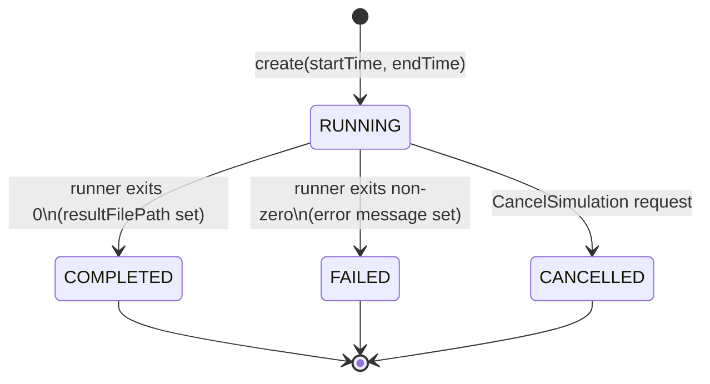
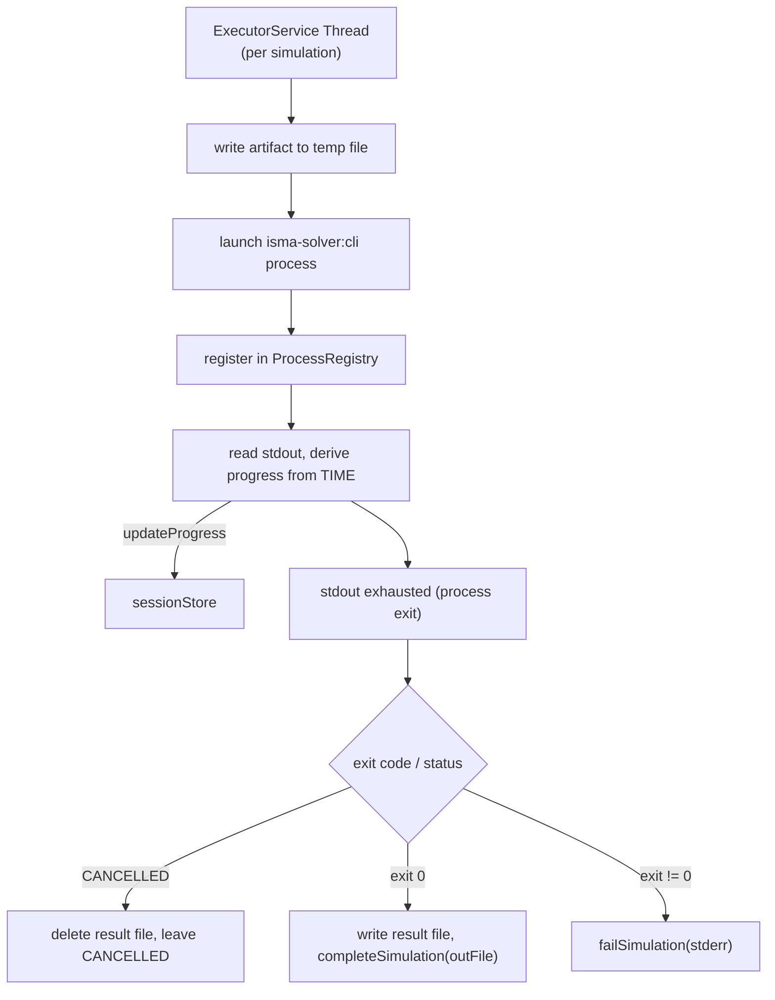

# Infrastructure Layer

## Overview

The `infrastructure/` module provides concrete implementations of domain
interfaces. As a pure orchestrator, it bridges the domain layer to the
**external CLI processes** (the LISMA compiler CLI and the batteries-included
simulation runner CLI) and the in-memory stores. The runner is the single source
of truth for the integration-method list: `ListSimulationMethods` asks the runner
(`--list-methods`) rather than loading a solver library in-process.

### DI Registration (`InfrastructureModule.kt`)

See `InfrastructureModule.kt` for the full Koin module definition. All registrations use `single()` — every DI resolution returns the same instance (singleton). The module registers:

- **Stores:** `IntegrationMethodsStore`, `SimulationSessionStore`, `CompiledModelStore` implementing domain interfaces
- **Process registry:** `SimulationProcessRegistry` (tracks runner processes for cancellation)
- **Compiler:** `CliLismaCompiler` (launches the standalone LISMA compiler CLI)
- **Integration methods:** `IntegrationMethodsStore` asks the runner CLI (`--list-methods`) for the bundled method names
- **Thread pool:** `Executors.newCachedThreadPool()` for async simulation supervision
- **Simulation executor:** `SimulationExecutorImpl` with dependencies on the session store, process registry, and executor service

---

## Stores

### CompiledModelStore

See `CompiledModelStore.kt` for the implementation. It stores compiled models (`CompiledModel` — the compiled `.class` bytes) in an in-memory `ConcurrentHashMap<String, CompiledModel>`. Keys are UUID strings generated on `create()`. Thread safety is achieved via lock-free `ConcurrentHashMap` operations. Models live for the entire daemon lifetime — no cleanup mechanism other than explicit `delete()`. No eviction or TTL; models accumulate until daemon restart.

**Operations:**

| Operation | Return | Behavior |
|-----------|--------|----------|
| `create(model)` | `String` (UUID) | Generates UUID, puts in map, returns ID |
| `get(id)` | `CompiledModel?` | Direct map lookup |
| `delete(id)` | `Boolean` | `map.remove(id) != null` |
| `exists(id)` | `Boolean` | `map.containsKey(id)` |

---

### SimulationSessionStore

See `SimulationSessionStore.kt` for the implementation. It stores sessions in an in-memory `ConcurrentHashMap<Long, SimulationSession>` with an `AtomicLong` starting at 1 for auto-incrementing ID generation. Thread safety is achieved via lock-free concurrent access. Sessions are immutable data classes; all mutations produce a copy via `session.copy(...)`.

**Operations:**

| Operation | Behavior |
|-----------|----------|
| `create(startTime, endTime)` | Generates ID, creates `SimulationSession(status=RUNNING)` |
| `get(id)` | Returns session or null |
| `getAll()` | Returns immutable snapshot `sessions.toMap()` |
| `update(id, session)` | Replaces if exists, throws `IllegalArgumentException` if not |
| `updateStatus(id, status)` | Creates copy with new status |
| `updateProgress(id, currentTime)` | Creates copy with new `currentTime` |
| `completeSimulation(id, resultFilePath)` | Sets status=COMPLETED, records file path |
| `failSimulation(id, error)` | Sets status=FAILED, records error message |
| `delete(id)` | Removes and returns true if present |
| `exists(id)` | `containsKey` check |

**Session state transitions:**

A session starts in `RUNNING` status. It transitions to `COMPLETED` when the runner process exits successfully (with `resultFilePath` set), to `FAILED` when the runner process exits non-zero (with an error message set), or to `CANCELLED` when the client sends a `CancelSimulation` request.



---

### IntegrationMethodsStore

See `IntegrationMethodsStore.kt` for the implementation. It uses Java `ServiceLoader` to load all `IIntegrationMethodFactory` implementations at startup, mapping factory names to factory instances in an immutable map. Thread safety is inherent since the map is read-only after initialization.

**Discovered methods (from isma-solver):**
- `euler`
- `rk2`
- `rk3`
- `rk31`
- `rkmerson`
- `rkfehlberg`

**SPI interface:** `IIntegrationMethodFactory` is defined in `isma-solver:lib-meta` (the solver library's SPI module). Each integration method module (e.g., `isma-solver:lib:euler`) provides a factory implementation registered via `META-INF/services`. The runner discovers these factories via ServiceLoader and reports the method names to the daemon (`--list-methods`); the daemon holds no solver library of its own.

---

## Simulation Executor

### SimulationExecutorImpl

The central orchestration component. It supervises one `isma-solver:cli` runner process per simulation: it writes the compiled `.class` to a temp file, launches the runner CLI, reads the runner's stdout (which streams the binary result records, one per time step) and derives progress from the TIME column, then writes the accumulated result to a file and updates the session when the runner exits.

**Dependencies:**

| Dependency | Type | Purpose |
|------------|------|---------|
| `ISimulationSessionStore` | SimulationSessionStore | Manages session state |
| `ISimulationProcessRegistry` | SimulationProcessRegistry | Registers the runner process so CancelSimulation can kill it |
| `ExecutorService` | CachedThreadPool | One thread supervises one runner process |

### Execution Architecture

See `SimulationExecutorImpl.kt` for the full implementation. The executor runs on a single `ExecutorService` thread per simulation:

1. **Artifact file:** Writes the stored artifact bytes to a temp file (`isma_model_<id>.bin`).
2. **Runner launch:** Builds the runner command (model file, start/end/step, method, optional accuracy/stability/event-detection flags) and launches the `isma-solver:cli` runner as a separate process. The runner's stderr is redirected to a temp file. The process is registered in `SimulationProcessRegistry`.
3. **Progress from stdout:** While the process is alive, the thread reads the runner's stdout, which streams the binary result records (header, then one row per time step). Each row's first column is TIME; the thread derives `progress = (t − t0) / (tEnd − t0)` from it and calls `sessionStore.updateProgress` when the time advances. The full byte stream is accumulated so the result can be written to a file on exit.
4. **Exit handling:** After the stdout stream is exhausted (process exit), the thread:
   - If the session is already `CANCELLED`, deletes the result file and leaves the session CANCELLED.
   - If the exit code is 0, writes the accumulated result bytes to the result file and calls `sessionStore.completeSimulation(id, outFile)`.
   - Otherwise, deletes the result file and calls `sessionStore.failSimulation(id, ...)` with the runner's stderr diagnostics.
5. **Cleanup:** The model and stderr temp files are deleted in a `finally` block. The process is unregistered.

**Thread model:**



### Runner Command

The runner is launched with:

```
<runner> --model <artifact.bin> \
         --start <t0> --end <t1> --step <h> --method <name> \
         [--accuracy <a> --accuracy-enabled] \
         [--stability-enabled] \
         [--gamma <g> --low-border <b>]
```

The runner streams the result to stdout in the existing binary format: a metadata header (column count, then per-column name length + UTF-8 name), flushed before the first row, followed by one row per time step (each a sequence of big-endian doubles; the first column is TIME), each row flushed as it is produced. The daemon accumulates the stream, derives progress from the TIME column, and writes the accumulated bytes to the result file on a successful exit.

### Runner Resolution Order

| Priority | Source | Form |
|----------|--------|------|
| 1 | `ISMA_RUNNER_CLI` env var or `isma.runner.cli` system property | launch script (executed directly), jar (`java -cp`), or lib directory (`java -cp dir/*`) |
| 2 | Fallback | the runner's own batteries-included distribution embedded in the daemon's dist (`runner/lib`), running `ru.nstu.isma.runner.SimulationRunnerCliKt` via `java -cp` |

The runner's full distribution (bin + lib, including the batteries-included integration-method jars) is embedded into the daemon's distribution by the `installRunnerDist` task in `app/build.gradle.kts` (a `Copy` of the runner's `installDist` output into `runner/`); the daemon holds no solver jars of its own.

### Exception Handling

See `SimulationExecutorImpl.kt` for the exception handling logic. The `executorService.submit()` block wraps the supervision in a try-catch. `InterruptedException` is only marked as FAILED if the session status is not already `CANCELLED`. Other exceptions always result in a FAILED status with the exception message.

---

## Process Registry

### SimulationProcessRegistry

See `simulation/SimulationProcessRegistry.kt` for the implementation. It implements `ISimulationProcessRegistry` with an in-memory `ConcurrentHashMap<Long, Process>`. `register` stores the runner process for a simulation, `unregister` removes it, and `kill` sends SIGTERM (`Process.destroy()`) to the registered process. This is how `CancelSimulation` terminates a running simulation.

---

## LISMA Compiler CLI Integration

### CliLismaCompiler

See `translation/CliLismaCompiler.kt` for the implementation. Implements `ILismaCompiler` by launching the standalone LISMA compiler CLI (`lisma-compiler:cli`) as a separate process: the LISMA source is written to the process's stdin, and the output is read from its stdout.

- **`compile(sourceCode)`** — runs the CLI in compile mode. On exit 0, the stdout bytes are the compiled `.class` file (`CompileOutcome.Success`). On exit 1, the stdout lines are parsed as `<row>:<col>:<message>` error lines (`CompileOutcome.Failure`).
- **`validate(sourceCode)`** — runs the CLI in `--validate` mode. On exit 0, no errors. On exit 1, the stdout lines are parsed as error lines.

The process is given a 60-second timeout.

**CLI resolution order:**

| Priority | Source | Form |
|----------|--------|------|
| 1 | `ISMA_COMPILER_CLI` env var or `isma.compiler.cli` system property | launch script (executed directly), jar (`java -cp`), or lib directory (`java -cp dir/*`) |
| 2 | Fallback | the `lib/` directory next to the daemon's jar (installDist layout), running `ru.nstu.isma.compiler.cli.LismaCompilerCliKt` via `java -cp` |

The CLI jar reaches the distribution via `runtimeOnly(project(":lisma-compiler:cli"))` in `app/build.gradle.kts`.
