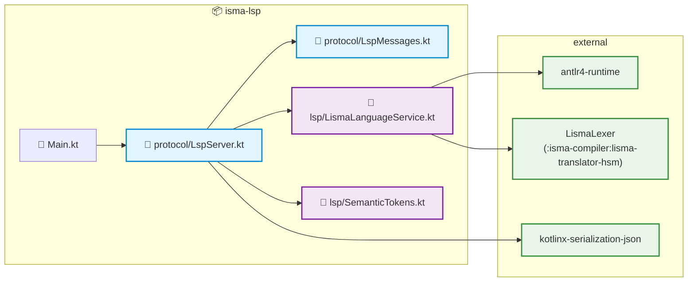
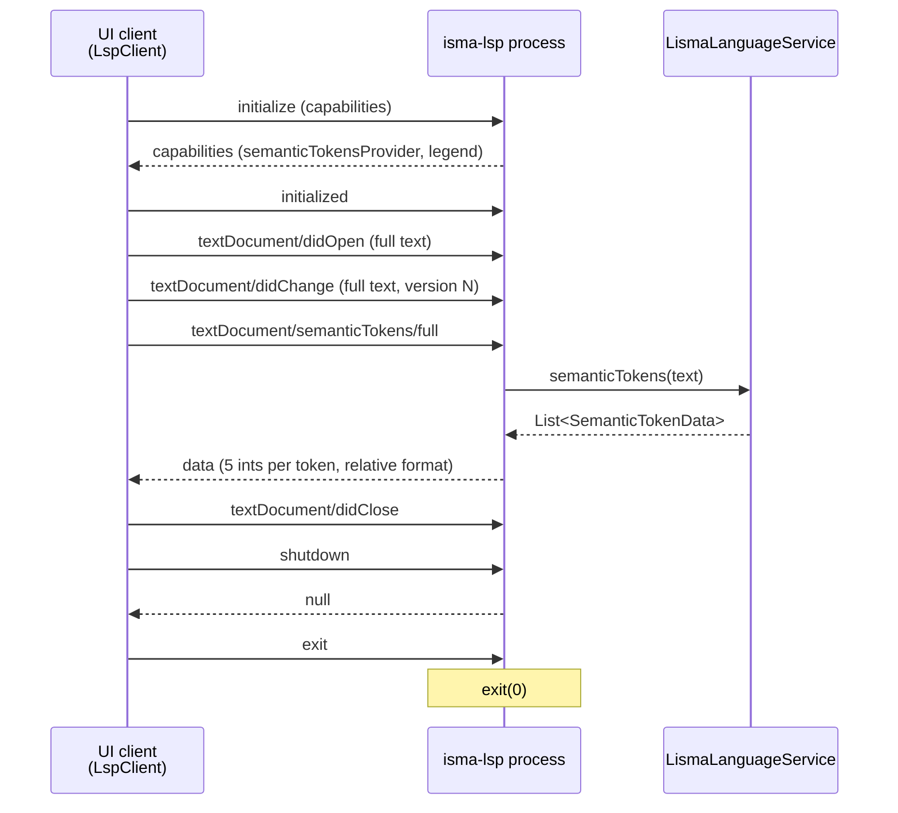

# isma-lsp — Architecture Overview

## Purpose

`isma-lsp` provides LISMA language features to UI clients over the Language Server Protocol. It replaces the previous gRPC `Highlight` RPC: instead of the UI asking the simulation server to tokenize source, each UI now launches a dedicated language server process and pulls semantic tokens over stdio.

The first cut covers **syntax highlighting only** (keywords, comments, numbers). The architecture is built for extension: new pull features are added as `LspServer.handle` branches backed by `LismaLanguageService` capabilities; push features (e.g. `textDocument/publishDiagnostics`) go through server-to-client notifications.

## Module Structure

```
isma-lsp/
├── build.gradle.kts                     # application plugin, JPMS module isma.lsp
├── smoke.py                             # stdio smoke test (Python, no deps)
└── src/
    ├── main/kotlin/ru/nstu/isma/lsp/
    │   ├── Main.kt                      # entry point
    │   ├── protocol/
    │   │   ├── LspMessages.kt           # Content-Length framing
    │   │   └── LspServer.kt             # JSON-RPC dispatch, document store
    │   └── lsp/
    │       ├── LismaLanguageService.kt  # semantic tokens (ANTLR4 lexer)
    │       └── SemanticTokens.kt        # legend, encoder, decoder
    └── test/kotlin/ru/nstu/isma/lsp/
        ├── lsp/
        │   ├── LismaLanguageServiceTest.kt
        │   └── SemanticTokensCodecTest.kt
        └── protocol/
            └── LspServerTest.kt
```

## Dependency Graph



The lexer is **not duplicated**: `LismaLanguageService` reuses the checked-in ANTLR4-generated `ru.nstu.isma.lisma.analysis.gen.LismaLexer` from `:isma-compiler:lisma-translator-hsm`.

## Communication Flow



- **Transport:** stdio. stdout carries the protocol only; diagnostics go to stderr.
- **Framing:** `Content-Length: N\r\n\r\n` + N UTF-8 bytes of JSON-RPC 2.0.
- **Document sync:** full document (LSP `textDocumentSync` kind 1) — the server keeps the latest full text per URI in a `ConcurrentHashMap`.
- **Pull model:** the UI requests `semanticTokens/full` after every edit; the server recomputes from the stored text.

## Token Model

`LismaLanguageService.semanticTokens` runs `LismaLexer` over the full text and maps lexer token types to three LSP token types:

| LSP type | Legend index | Lexer tokens |
|----------|--------------|--------------|
| `keyword` | 0 | `CONST_KEYWORD`, `STATE_KEYWORD`, `FOR_KEYWORD`, `IF_KEYWORD`, `ELSE_KEYWORD`, `FROM_KEYWORD`, `MACRO_KEYWORD`, `SET_KEYWORD` (8 keywords) |
| `comment` | 1 | `COMMENT` (block), `SL_COMMENT` (line) |
| `number` | 2 | `FloatingPointLiteral`, `DecimalLiteral` |

All other lexer tokens are filtered out. The mapping mirrors the removed server-side `HighlightLismaHandlerImpl`, so UI token parity is preserved.

### Multi-line tokens

Lexer tokens can span lines (block comments, line comments include the trailing newline). `semanticTokens` splits every token at line boundaries into per-line `SemanticTokenData(line, startChar, length, type)` segments, so the client never has to handle cross-line spans.

### Wire format

Tokens are encoded in the LSP **relative** format — 5 integers per token `[deltaLine, deltaStart, length, tokenType, tokenModifiers]` (see [02-protocol.md](02-protocol.md)). `SemanticTokensEncoder`/`SemanticTokensDecoder` in `SemanticTokens.kt` implement the format; the decoder is the reference for UI client implementations.

## Extension Model

- **New pull feature** (e.g. completion): add a method to `LismaLanguageService`, a branch in `LspServer.handle`, and the capability in `buildInitializeResult`.
- **New token type:** add an entry to `LismaTokenType` and to the `typeFor` mapping — the legend is derived from the enum, so the wire format and client legend stay in sync.
- **Push feature** (e.g. diagnostics): send a server-to-client notification from the dispatch loop; clients already have a reader loop for such messages.

## Build

```bash
./gradlew :isma-lsp:build          # compile + 17 tests
./gradlew :isma-lsp:installDist    # distribution with bin/isma-lsp launcher
```

- `application` plugin: main class `ru.nstu.isma.lsp.MainKt`, JPMS module `isma.lsp`.
- Dependencies: `:isma-compiler:lisma-translator-hsm` (lexer), `antlr4-runtime`, `kotlinx-coroutines-core`, `kotlinx-serialization-json`, `slf4j-api`.
- The ANTLR tool/runtime version warning (`Tool version 4.10.1 ... runtime 4.13.2`) is pre-existing and harmless.
